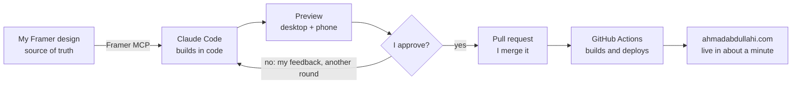

# How I Rebuilt My Portfolio as a Designer Using AI

November 25, 2026 · Ahmad Abdullahi

I took my portfolio from a customized Framer template to a hand-built site in code that I fully own. I designed every decision myself and used AI (Claude Code) as my build partner. The new site is live at [ahmadabdullahi.com](https://ahmadabdullahi.com), hosted for free on GitHub Pages, and I can edit every part of it without AI.

| | Before | After |
| --- | --- | --- |
| Platform | Framer (Callum Hayes template, customized by me) | Astro site in my own GitHub repo |
| Hosting | Framer | GitHub Pages, free |
| Who can change it | Me, inside Framer's editor | Me, from any browser, with a written guide |
| How it was made | Template + my visual edits | My design direction + AI-assisted code, shipped in 14 reviewed pull requests |

This write-up is for designers who want to see how I think and work, and for anyone curious how a designer can rebuild a portfolio with AI without giving up control of the design.

## Where it started: a Framer template I made my own

My first real portfolio, "Portfolio v2 (Live)", was built in Framer on top of a template by Callum Hayes. I used the template for its structure, then designed the rest myself: the warm paper background, the serif and sans type pairing, my case studies for IU LART, the IU MSA Club and Turkuaz Cafe, my experience list and my About content.

That version taught me what I wanted a portfolio to feel like: calm, editorial and personal rather than flashy. It also became the reference I handed to AI later, so the rebuild started from my own design decisions instead of a blank prompt.

## Why I rebuilt it in code

I wanted a portfolio that was truly mine: my own code, in my own GitHub repository, not tied to one tool's editor or plan. My brief was simple: rebuild Portfolio v2 in code without copying it exactly, keeping its spirit and bringing it up to current design trends.

- **Ownership:** the site, its history and its hosting all live in my GitHub account.
- **Range:** building in code shows I can design *and* ship, which supports the "builder" in my headline.
- **Room to grow:** custom pieces like a working beat player or a hobbies section are easier to make exactly how I want in code.

## Setting up the workflow

The setup connected three things: my existing design in Framer, Claude Code as the builder, and my GitHub repository as the home for the new site.

1. **Claude Code in the browser.** I worked in a Claude Code cloud session linked to an empty GitHub repo (`ahmad-portfolio`, later renamed `personal-portfolio`).
2. **The Framer MCP.** I connected Framer to Claude through MCP (Model Context Protocol). This let Claude open my "Portfolio v2 (Live)" project directly: read its pages, text, case studies and images, and take screenshots of the live site.
3. **Attaching my design.** I pointed Claude at my Framer project as the source of truth. Images were downloaded straight from Framer, so nothing had to be re-exported by hand.
4. **Network access.** The session's environment only allowed approved sites, so I approved Framer's image host once (and later Figma's upload host the same way).

The result was a loop where Claude could see what I had designed, rebuild it, and show me the outcome before anything went live.

Every change went around this loop until I approved it. Only then did it become a pull request and go live.

## Setting the direction

I started with one open-ended prompt and let the AI ask me questions before it wrote any code. My first message was:

> "I want to rebuild a portfolio I have on Framer… But I don't want it to be exactly the same but follow current design trends using the context from my current portfolio. Help me rebuild my portfolio into code… and ask me any questions you need to do this."

Claude came back with a short set of choices, and I made each call:

| Question | My decision |
| --- | --- |
| How should it be built and hosted? | Astro, hosted on GitHub Pages |
| What visual direction? | "Refined editorial": warm paper tones, serif headings, lots of space |
| How deep should case studies go? | Full case study pages, not just cards |
| Anything extra? | A certificates section and a credits & licensing page |
| Where do images come from? | Downloaded directly from my Framer site |

Asking for questions first mattered. It turned a vague "rebuild my site" into a brief with clear constraints, which is how I'd approach any design project.

## How I worked: preview first, then build

For most of the project I was directing, reviewing and cutting while AI built. I rarely let anything go into code before I had seen it.

- **Mock up before building.** For bigger ideas I asked for 2–3 options as a visual preview first (for example, three directions for the "Off the clock" section). I picked one, combined parts, and only then said "build it."
- **Screenshots at desktop and phone width every time.** Every change was checked at 1440 px and at iPhone size before I approved it.
- **Specific, visual feedback.** I gave direction the way I'd give it to a teammate: "make the photo fill the whole card," "center my picture on mobile," "use the photo, don't redraw it." When words weren't enough, I attached a reference image.
- **A guiding filter.** I kept asking whether each idea was *simple, informative, clear and authentic*. That filter killed several ideas I had liked at first: an animated scrolling strip, a spinning badge, an editing-timeline layout and a hidden easter egg.
- **Asking for honest critique.** Midway I asked Claude to review the site as an experienced designer would, then acted on the parts I agreed with and skipped the rest.

### Real problems we hit and fixed

| Problem | What fixed it |
| --- | --- |
| On iPhone Safari the page scrolled sideways and the bottom didn't show | Layout grids were constrained so wide images couldn't push the page wider |
| After I renamed the repo, the live site loaded with no styles | A fresh deploy so the site picked up its new address |
| Recreating the site in Figma for hand edits stopped halfway | Figma's free plan limits AI tool calls, so I kept iterating in code instead |
| The domain needed to move from Framer without breaking | DNS records pointed to GitHub, then Framer was disconnected (see Shipping) |

## Key design decisions

Almost every section was reworked several times, and the final version is usually simpler than the first.

| Section | Where it landed | Why |
| --- | --- | --- |
| Color and type | Warm paper background, a single navy accent, Fraunces serif + Manrope sans, light and dark mode | One strong accent reads as intentional; navy felt calmer and more professional than the green I started with |
| Hero | One headline ("Designer, creative thinker, and builder based in *Indiana*."), one supporting line, two buttons, a new photo | I cut the status pill, the greeting, the social icons and the animations. I dropped "Product" from the headline: I'm new in the role, so "Designer" is the honest claim |
| Tools | "Tools I've used" under My Work: Figma, Framer, Claude Code, Cursor, GitHub, Square, WordPress | Tools belong next to the work they made; on phones they collapse to icons |
| My Work | Three equal-size project cards | No single project should overshadow the others |
| About Me | A three-paragraph story about my path into design, with my photos placed between paragraphs | Rewritten to say less about gaming and more about how I became a designer and how I design |
| When I'm not designing | Two rows: the game I'm playing, a playable beat I made, and three fitness cards | Personality is seasoning. I cut a PC spec list and an extra image card so this section doesn't outweigh my work |
| Experiences | Job list with my certificate folded in underneath | A whole section for one certificate looked thin |
| Contact and nav | "Let's Work" and "Let's Connect" in the hero, "Message Me" and "Email Me" in the contact card | One clear way to reach me; I removed a duplicate nav button and the footer icons |

## Shipping: pull requests and my own domain

Nothing reached the live site without a pull request that I chose to merge: 14 in total, each one a reviewable batch of changes.

- **Branch, review, merge.** Claude worked on a separate branch. When I was happy with the screenshots, I said "open the pull request and merge it."
- **Automatic deploys.** Merging into `main` triggered a GitHub Action that built the site and published it to GitHub Pages in about a minute.
- **Moving my domain.** To move ahmadabdullahi.com off Framer, I:
    1. added the domain in the repo's Pages settings;
    2. replaced the Framer records in Hostinger's DNS with GitHub's four A records and a `www` CNAME (no nameserver change needed);
    3. had the site redeployed under the new address;
    4. disconnected the domain from Framer;
    5. turned on HTTPS once GitHub's DNS check went green.

The site needed no new code to switch domains. The build reads its address from GitHub, so it picked up ahmadabdullahi.com on its own.

## Owning it: a guide so I never depend on AI

The last step was making sure I can maintain the site completely on my own. I asked for written instructions for every part of the portfolio, kept in the repo's [README](../README.md), where I'll always find them.

- **One file for nearly all the text.** The code was reorganized so nearly all of the site's text lives in `src/data/site.ts`: hero, About Me, experiences, game, beat, contact.
- **Uploads instead of code.** Swapping the game cover, a certificate image or a photo is an upload plus, at most, a one-line change.
- **A section-by-section manual.** The README covers:
  - editing on the GitHub website
  - safe-editing rules, like using the curly apostrophe ’
  - every section of the site, with case studies in detail
  - pull requests and undoing a change
  - fixing a failed build
  - my domain settings

AI helped me build the site, but keeping it running doesn't depend on AI. That was the point.

## What I learned, and tips if you're building yours

The biggest lesson: AI is a fast builder, but the taste, the cuts and the final calls still have to come from you.

1. **Start from your own design.** Hand the AI something you made (a Framer site, a Figma file, screenshots) so it builds on your decisions, not generic ones.
2. **Make it ask you questions first.** A short Q&A turns "rebuild my site" into a real brief: stack, style, scope.
3. **Preview before you build.** Ask for 2–3 options as mockups, pick one, then commit to code.
4. **Check every change on desktop and phone.** Many of my fixes only showed up on an iPhone-sized screen.
5. **Have a filter and use it to cut.** Mine was "simple, informative, clear, authentic." Most of my best edits were removals.
6. **Ask for honest critique, then decide.** Treat AI feedback like a reviewer's: useful, but you choose what to act on.
7. **Keep humans in the merge.** Use pull requests so nothing goes live until you approve it.
8. **Write yourself a manual.** Before you finish, get instructions for changing everything yourself, so the site stays yours.
