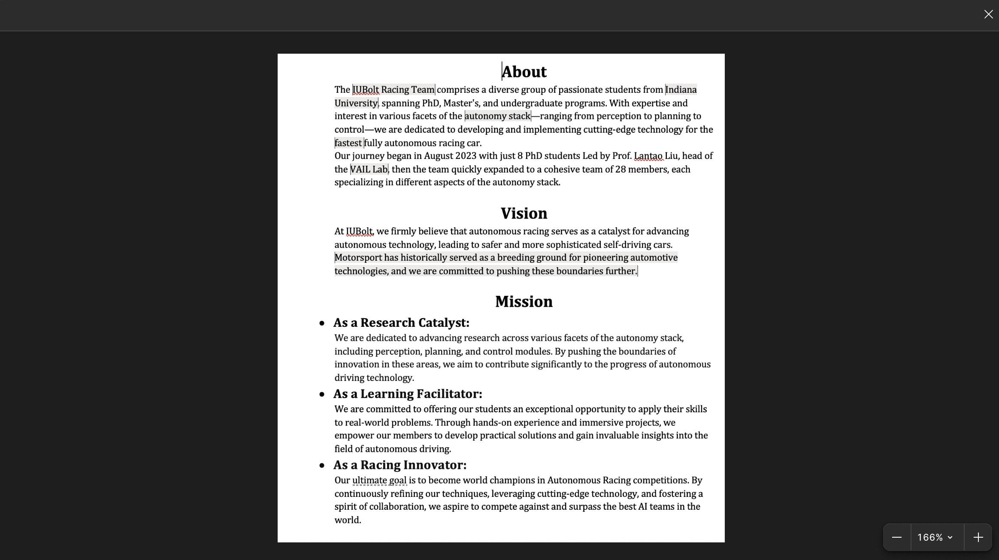
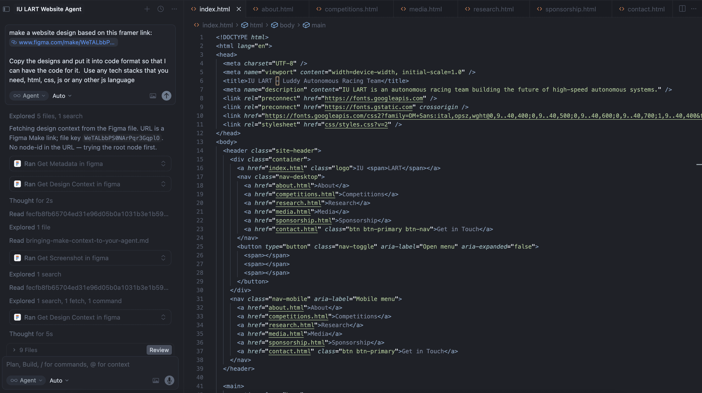
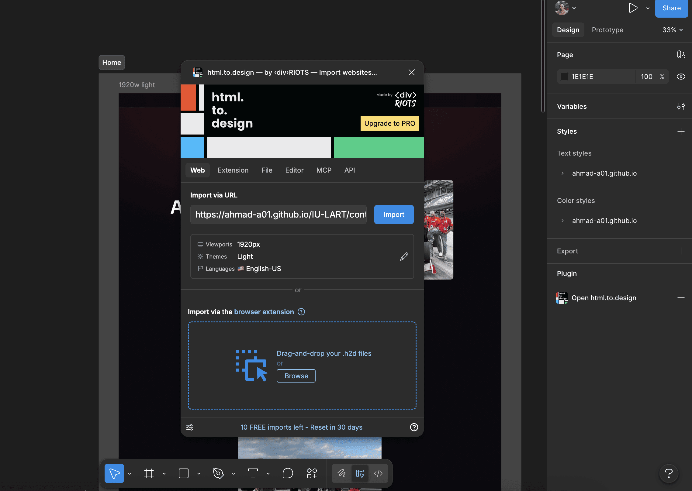
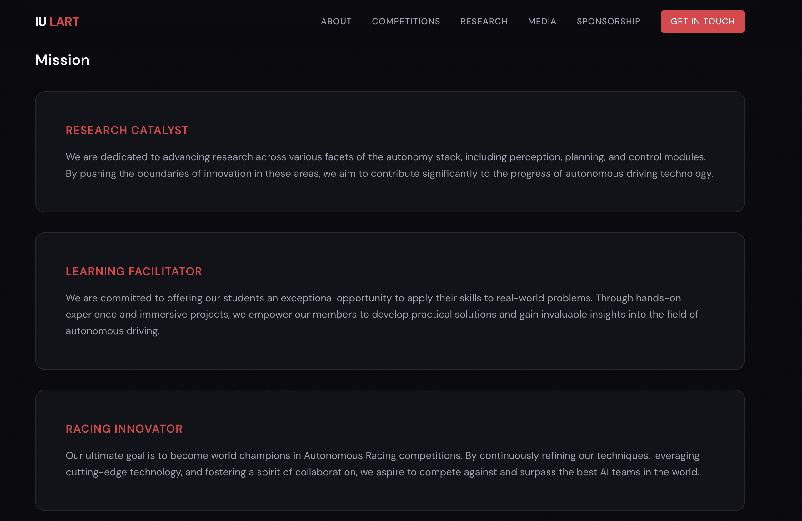
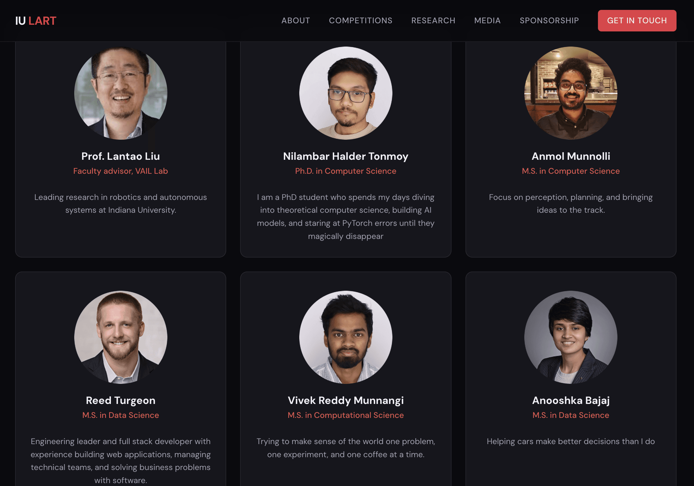
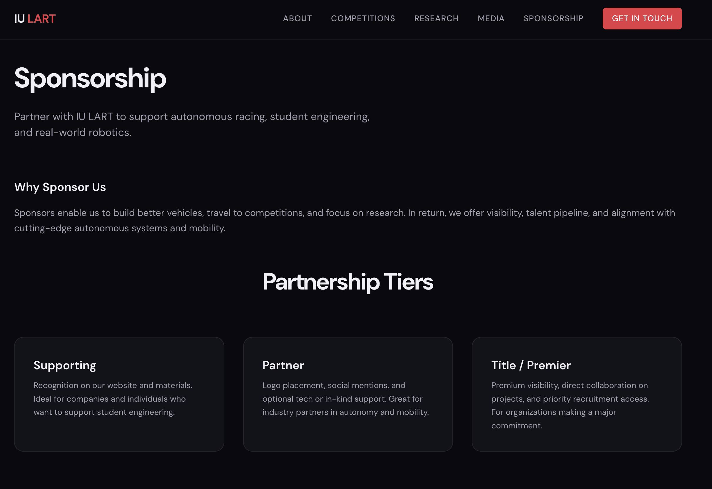

import Gallery from '../../../components/Gallery.astro';
import diptych1 from './diptych-1.png';
import diptych2 from './diptych-2.png';
import triptych1 from './triptych-1.png';
import triptych2 from './triptych-2.png';
import triptych3 from './triptych-3.png';

## The Challenge

The IU LART (Indiana University Luddy Autonomous Racing Team) had no web presence. Potential sponsors, conference attendees, and prospective members had nowhere to go. The team needed a professional public site that reflected IU's brand, communicated their research and competition history, and opened a clear path for sponsorship.

I designed and built it end-to-end as an undergraduate research project, running the full cycle from stakeholder brief to deployed, publicly accessible website with the guidance of a PhD student and the front-end code support from an undergrad student.

## How I approached it

Rather than a linear handoff between design and code, the process was a continuous loop. Prototyping, generating code, deploying, and importing back into Figma for refinement. Here are the four decisions that shaped the outcome.

### 1 - Started with a structured brief, not a blank canvas

I ran a requirements session with the team's stakeholder to define the site's eight pages, content hierarchy, and brand direction before touching any design tool. This written brief, covering everything from copy excerpts to IU's cream and crimson palette, became the single source of truth fed directly into prototyping.

### 2 - Used AI to get a visual anchor fast

I fed the brief into Figma Make and had a multi-page prototype in minutes. This wasn't about shipping AI output. It was about getting something concrete enough for the stakeholder and me to align on typography, layout, and hierarchy before writing a single line of code. The prototype's light cream-on-crimson direction ended up being replaced by a darker theme in the final design, but it compressed weeks of early alignment into one session.

<Gallery images={[diptych1, diptych2]} alt="IU LART project screens" />

### 3 - Generated the codebase with Cursor, then refined it in Figma

I used Cursor's AI agent to translate the Figma prototype into a full HTML/CSS/JS codebase across all seven pages. Once the site was deployed on GitHub Pages, I imported it back into Figma using the html.to.design plugin so design revisions were always based on what was actually live, not a drifting static file. This loop between code and design is what kept the final product consistent across rounds of stakeholder feedback.

### 4 - Reviewed all seven pages side by side before every update

Each round of stakeholder feedback happened with all seven pages open simultaneously in Figma. This made it easy to catch inconsistencies, a spacing decision on the Competitions page that didn't match Research, for example before pushing changes to the live codebase. The final design landed on a dark theme with IU Crimson accents and real team photography, a significant departure from the AI prototype's lighter direction.

<Gallery images={[triptych1, triptych2, triptych3]} alt="IU LART project screens" />

## The Result

IU LART went from no web presence to a live, eight-page site that sponsors, conference attendees, and prospective members can actually find. The dark theme with IU Crimson accents gives the team a visual identity that reads as serious and technical without sacrificing clarity.

