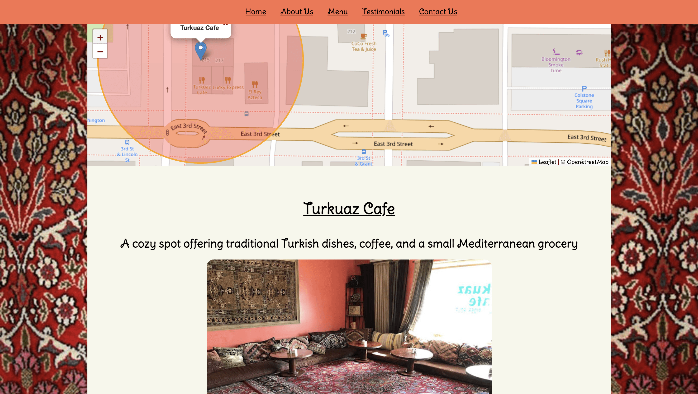
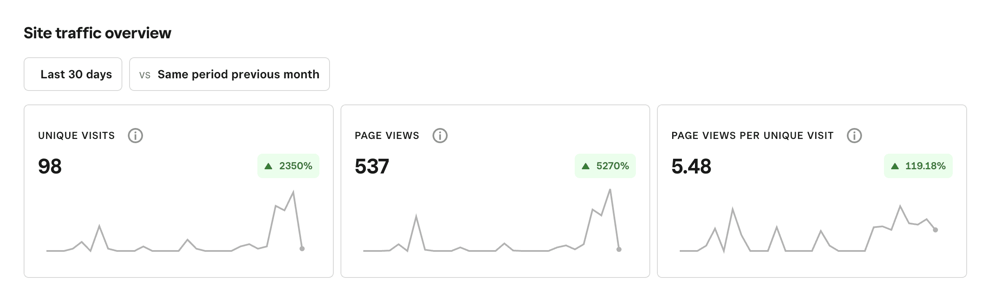
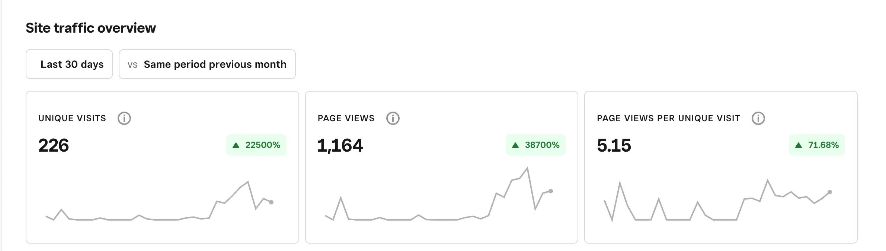

import Gallery from '../../../components/Gallery.astro';
import diptych1 from './diptych-1.jpg';
import diptych2 from './diptych-2.png';
import triptych1 from './triptych-1.png';
import triptych2 from './triptych-2.png';
import triptych3 from './triptych-3.png';

## Overview

Turkuaz Café is a Turkish restaurant in Bloomington, IN, known for its rich cultural dining experience including traditional floor seating and authentic Turkish cuisine.

Before this project, Turkuaz Café had **no official website**, which meant potential customers could only find them on DoorDash or by visiting in person. This limited their visibility, story, and ability to grow their customer base.

I designed and built their first website from scratch. I focused on creating a strong online presence that communicates their identity while making it easier for people to order, reserve, and connect with the restaurant.

## The Problem

Without a website, Turkuaz Café struggled to:

- Showcase their unique atmosphere and story
- Provide quick access to their menu, reservation options, or provide catering services
- Accept online orders directly

The goal was to create a platform that highlights their **authentic Turkish culture**, simplify the **ordering process**, and help drive **more in-person visits**.

<Gallery images={[diptych1, diptych2]} alt="Turkuaz Cafe project screens" />

## What I did

Once I noticed they didn't have a website, I used this opportunity to **first code the website in HTML and CSS** for a web design class project. That way I could visualize how the content, navigation, and images should flow for the restaurant as well as completing a school project. This helped me quickly test design ideas and refine the structure before moving to a CMS platform.

## The Solution

Once I had a clear layout, I decided to **transition the project to Square**, since the restaurant already used **Square POS** in-store. This allowed for seamless integration between their payment system, menu management, and online orders.

**My focus areas:**

- Building a clean, minimal design that reflects their culture-rich identity
- Improving usability with a simple and intuitive navigation
- Adding dedicated sections for **Menu**, **Reservations**, **Catering**, and **Online Ordering**

<Gallery images={[triptych1, triptych2, triptych3]} alt="Turkuaz Cafe project screens" />

## The Impact

I designed and built their first website from scratch. I focused on creating a strong online presence that communicates their identity while making it easier for people to order, reserve, and connect with the restaurant.

The new website gives Turkuaz Café a professional online home that brings their story to life. Customers can now:

- View the full menu anytime
- Book reservations online
- Sign up for catering services
- Order directly through the café’s Square system (no third-party apps that cost more)

The result is a clean, mobile-friendly design that enhances accessibility and better represents their brand identity.

This project taught me how to combine **technical skills** with **platform adaptability** which started from code to full implementation in a CMS platform. It also reinforced how impactful a well-designed online presence can be for small, locally owned businesses.

By building from the ground up, I helped Turkuaz Café expand their reach, strengthen their brand identity, and make their customer experience more convenient. All from the devices in their customers’ hands.

